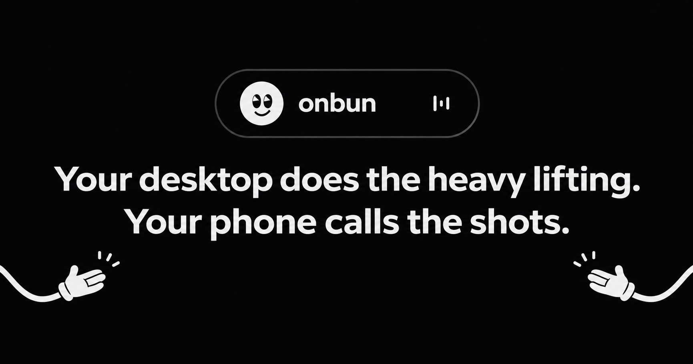

A little island connecting your computer, your phone and your favorite apps.

[Website](https://onbun.app/) · [Apps](https://onbun.app/apps) · [Guide](https://onbun.app/docs) · [Releases](https://github.com/MathieuDvv/WinMore-releases/releases)

## Get Onbun

| Platform | Download |
| :-- | :-- |
| **Windows** | `Onbun-Setup-<version>.exe` |
| **macOS** | `.dmg`, `arm64` for Apple silicon, `x64` for Intel |
| **Linux** | `.AppImage` or `.deb` |
| **iPhone · Android** | Attached to the release when available |

Every file is on the [latest release](https://github.com/MathieuDvv/WinMore-releases/releases/latest). Onbun updates itself from there.

## What's in this repository

The source code is private. This repository holds only what installed copies fetch.

| Path | Contents |
| :-- | :-- |
| `index.json`, `apps/` | The app catalog in **Settings → Library** |
| `bundles/` | Single-file copies of apps for older versions |
| `docs/` | The website, [onbun.app](https://onbun.app/) |

Formerly WinMore. Files named <code>WinMore-…</code> are identical copies for installs from before the rename. Apps and updates run on your PC with Onbun's access, and only the owner of this repository publishes them.
